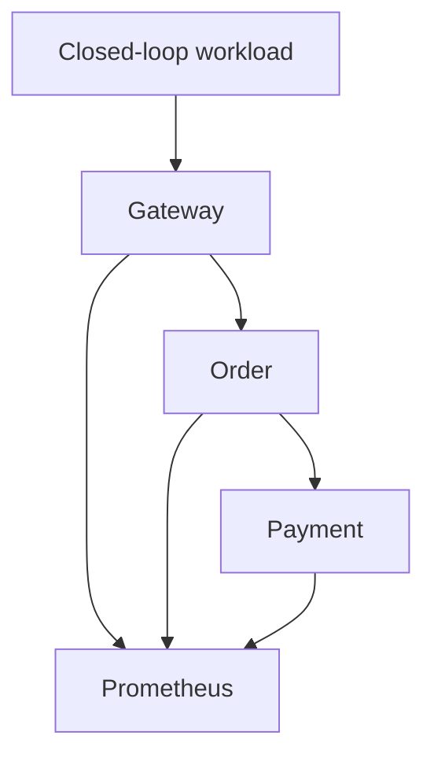
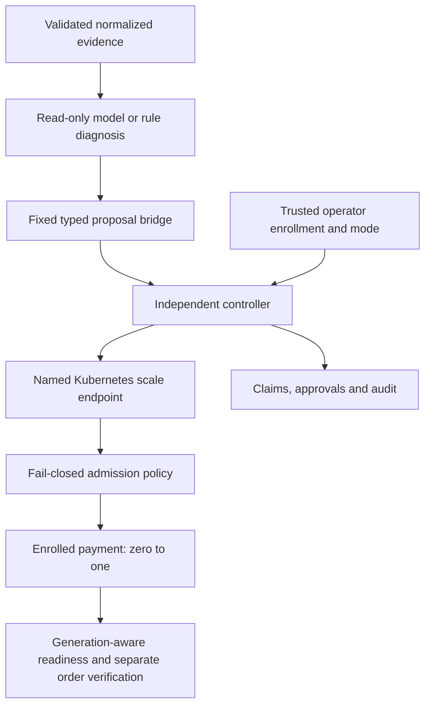

# SafeHeal AI architecture

## Application data plane

The gateway validates a synthetic order, the order service calculates its value, and payment returns a simulated receipt. The order service validates the receipt before returning a confirmed result. Services run independently from one shared app factory. HTTP POST operations have no automatic retries. Request IDs correlate JSON logs; they are not authenticated identities. Orders and payments are synthetic and not durably persisted.

Each service is a one-replica Deployment behind a ClusterIP Service in `safeheal-dev`. CoreDNS provides names; probes and native Kubernetes controllers manage ordinary container/Pod lifecycle. The local kind node shares control-plane and workloads on one developer machine. This is not node-level high availability. Workloads use non-root execution, dropped capabilities, read-only roots, resource bounds and no automatic API token. No public ingress or network-policy enforcement is claimed.

## Evidence and diagnosis

Prometheus supplies bounded request/error/latency and scrape-availability samples. The deterministic detector tracks incident transitions and stores timestamps/evidence in SQLite. Read-only diagnosis tools use fixed queries. Aggregation validates actual sample freshness, supported normalized fields and content-addressed record references. Arbitrary log prose and labels are not passed as instructions.

The bounded OpenAI-compatible provider returns only hypotheses over fixed service/class choices. The validator rejects unknown fields, unsupported references, invalid confidence and unsafe proposals. Confidence is capped and remains uncalibrated. Provider timeouts/outages and invalid evidence yield documented abstention or low-confidence fallback. Durable notification claims suppress repeated IDs/evidence and fail closed after ambiguous interrupted work.

## Authority and recovery

The immutable recovery catalog contains one action, `restore_payment_replica`. The independent controller pins Deployment UID/template, verifies ownership and live desired-zero state, and atomically tests identity/version/scale spec before adding replicas one. A separate short-lived executor token has named-resource scale-only permissions. API-server admission independently restricts the dedicated service account's allowed transition. The model has no token, shell, kubeconfig, approval authority or recovery executor.

Dry-run is default. Operator approval expires, binds the request/spec/generation and is single-use. Autonomous mode requires trusted operator opt-in. Journal claims precede writes; duplicate, single-flight, cooldown and hourly limits persist per journal. A running/uncertain write blocks future execution instead of being retried. Three consecutive exact-generation readiness observations verify controller success. The operator harness separately verifies Service routing and real confirmed orders.

## Experiment boundary

The trusted lab harness has administrative credentials to introduce a recorded fixture and clean it up after measurement. It is never a model tool. Every trial uses a fresh operator-enrolled journal/token and retains its audit. Rate-limit behavior across these episode resets is not evaluated. Cleanup is excluded from recovery metrics. Native reconciliation, fixed-rule decisions and genuine model diagnosis are separate arms; fallback cannot count as model success.

Raw business measurements, telemetry, platform observations, trial records and hash manifests support offline replay. Censored times remain unknown beyond the horizon. Shared-host contention, closed-loop throughput, carryover and a single scale-zero scenario limit conclusions.

## Trust assumptions and limits

The OS operator, provider endpoint configuration, enrollment files and fixture harness are trusted. Admission/RBAC do not protect against the cluster administrator changing policy. Audit chaining detects corruption but an OS administrator can rewrite local records. No production multi-user isolation, remote tamper-proof service, causal root-cause proof or general autonomous remediation is established.

See [safe recovery](docs/SAFE_RECOVERY.md), [robustness](docs/AI_ROBUSTNESS.md), [experiments](docs/CONTROLLED_EXPERIMENTS.md) and the [research report](docs/RESEARCH_REPORT.md) for exact contracts and retained limitations.
