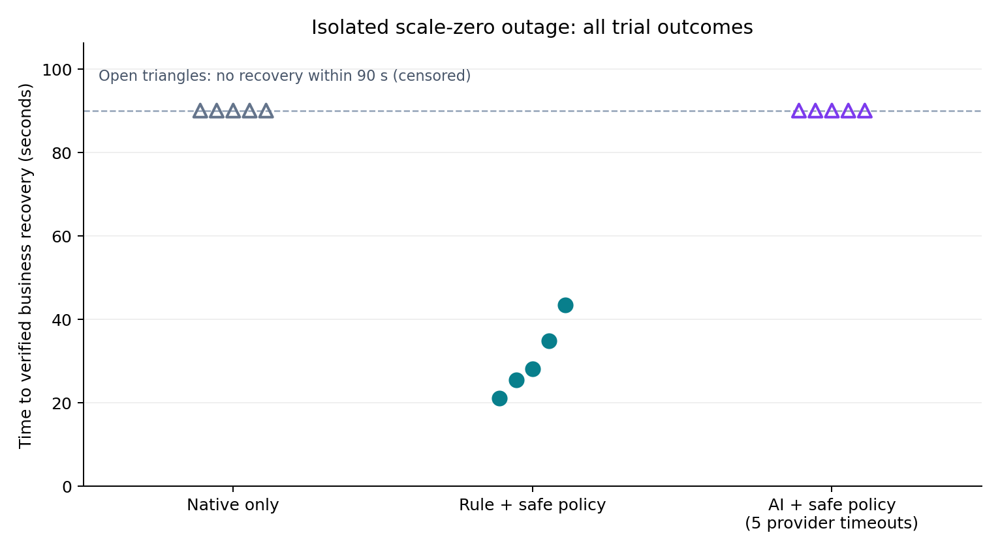
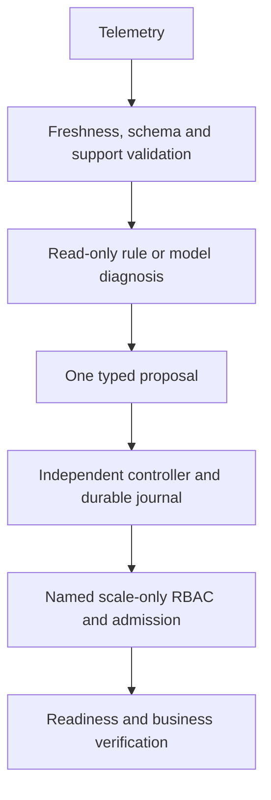

# SafeHeal AI

An inspectable Kubernetes incident-response testbed that separates model diagnosis from recovery authority.

SafeHeal observes a synthetic gateway → order → payment application, validates bounded evidence, and compares native behavior, a fixed symptom rule and real-model diagnosis. A separate deterministic controller permits only one enrolled action: restore the payment Deployment from desired replicas zero to one. The model receives no shell or Kubernetes credential.

**Status - 25 October 2026:** The ten original engineering milestones are complete. The repository is public, and main requires pull requests plus test, kubernetes and secrets checks. The CPU-model release extension is under verification; Windows: 558 passed, 2 expected skips. No AI advantage is claimed. See [project status](PROJECT_STATUS.md).

## Run the end-to-end demo

**Verified reference:** [Successful live demo](https://github.com/Jill-Vekariya/safeheal-ai/actions/runs/40145365194) · [Verified summary](evidence/demo/ci-40145365194/summary.md) · [Download GitHub artifact](https://github.com/Jill-Vekariya/safeheal-ai/actions/runs/40145365194/artifacts/12580581966) · [Permanent raw archive](evidence/demo/ci-40145365194/artifacts.zip)

Source: 9f6e268d2b5d. Linux: **537 passed, 1 skipped**; Windows: **536 passed, 2 skipped**. Both fresh recovery modes, all twelve required stages and the downloaded artifact/audit checks passed. [Normal CI](https://github.com/Jill-Vekariya/safeheal-ai/actions/runs/40145364797) also passed, including six labelled fault repetitions.

**[Open the GitHub Actions demo](https://github.com/Jill-Vekariya/safeheal-ai/actions/workflows/demo.yml)** and choose **Run workflow → main**. It creates a fresh isolated Docker-kind cluster, runs tests and replay, verifies real orders, demonstrates native/autonomous/approval recovery, checks observability and incidents, and publishes a verified summary plus downloadable evidence. No provider key is needed.

[Step-by-step demo and four-minute presentation](docs/DEMO.md) includes expected results, Windows/Linux commands, the existing lab shortcut and investigation steps. Diagnosis is explicitly labelled historical fallback replay; recovery fixtures run live. The five original larger-model requests timed out. A separate CPU profile produced six grounded diagnoses on six retained development incidents; two subsequent Windows studies were interrupted and remain explicit incomplete cohorts. The manual workflow now also runs a fresh real-model study in an isolated Linux job. See [CPU profile and limitations](docs/LOCAL_CPU_MODEL.md).

## Start with the evidence

| Material | What it establishes |
|---|---|
| [Research report](docs/RESEARCH_REPORT.md) | Question, methodology, results, threats to validity and future work |
| [Original controlled findings](evidence/day9/analysis/FINDINGS.md) | Five native and five fixed-rule trials; explicit missing AI slots |
| [Configured local-model findings](evidence/day9/analysis-local/FINDINGS.md) | Fifteen live trials including five actual local-provider attempts; failures remain explicit |
| [Raw original cohort](evidence/day9/run-primary) | Request measurements, telemetry, audits and integrity manifest |
| [Robustness evaluation](docs/AI_ROBUSTNESS.md) | Exact-source before/after synthetic failure handling; 27/36 → 36/36 development cases |
| [Safe recovery contract](docs/SAFE_RECOVERY.md) | Allowlist, approval/dry-run modes, least privilege, claims and verification |
| [Reproduction guide](docs/REPRODUCIBILITY.md) | Clean checkout, offline replay and guarded live lab commands |
| [End-to-end demo](docs/DEMO.md) | A reviewable walkthrough with explicit limitations |
| [Portfolio and interview preparation](docs/PORTFOLIO.md) | Evidence-based resume/SOP wording and 20 technical questions |

In the original 45-second baseline cohort, fixed-rule recovery succeeded in 5/5 trials (observed mean 19.04 s); native behavior did not recover within the horizon in 5/5 trials. Native actual recovery times are unknown. Desired replicas zero is valid Kubernetes state, so this fixture deliberately favors an explicit restore policy. It is not proof of generic crash-recovery improvement or an AI advantage.


The separate 90-second local-model cohort recorded rule recovery in 5/5 trials (mean 30.544 s), native 0/5 and AI arm 0/5. Provider outcomes: `{'provider_timeout': 5}`. Failed/fallback diagnoses did not authorize recovery. These results do not establish model diagnostic accuracy or general performance. The two cohorts are not pooled.



## Offline review

Python 3.12 is the tested runtime. From a checked-out release:

```powershell
py -3.12 -m venv .venv
.\.venv\Scripts\python.exe -m pip install -r requirements.lock
.\.venv\Scripts\python.exe -m pip install --no-deps -e .
.\.venv\Scripts\python.exe -m pytest -q
.\.venv\Scripts\python.exe scripts/reproduce.py --output .local/reviewer-replay
```

On Linux/macOS use `.venv/bin/python`. Choose a new replay directory. Offline reproduction checks byte integrity, replays raw recovery metrics and reads audit chains without model calls or cluster access. Live data collection and figure rendering have separate dependencies and explicit commands in the [guide](docs/REPRODUCIBILITY.md). Default provider tests use mocks; real-provider integration is opt-in.

## Run the application

With Docker Desktop using Linux containers:

```powershell
docker compose up --build -d --wait
.\.venv\Scripts\python.exe scripts/smoke.py
docker compose down
```

The gateway binds only to loopback `127.0.0.1:18080`. The synthetic application makes no real payment. Docker/Kubernetes resources for other projects are not managed by these commands.

For a dedicated kind lab, follow [Kubernetes setup](docs/KUBERNETES.md). The guarded scripts always use project-specific kubeconfigs and context. Fault execution requires `--execute`; default recovery/experiment commands are read-only plans or preflight. The current Windows acceptance lab is separately named `safeheal-day7` because the original node's API port was blocked by Windows; no global Docker reset or default-context change was used.

## How authority is bounded



The controller checks enrolled identity/spec and exact live state before one conditional zero-to-one write. Default dry-run, expiring approval and operator-enabled autonomous modes are independent of model output. Ambiguous writes block retry; duplicate/single-flight/rate limits and audit records persist. API-server admission restricts the executor identity separately from host controller checks. The model cannot approve itself, reset the journal, select commands or expand the allowlist.

## Repository map

- `services/`: application, deterministic incident detection, bounded diagnosis and independent recovery.
- `infrastructure/`: pinned kind/Kubernetes, observability, RBAC and admission policy.
- `scripts/`: guarded operator harnesses, experiments, analysis and offline reproduction.
- `tests/`: application, evidence, provider, recovery and failure-path checks.
- `evidence/`: retained successful, failed, censored and unrun measurements.
- `docs/`: operational contracts, research report, architecture context and reviewer materials.

[Architecture](ARCHITECTURE.md) explains trust boundaries. [Roadmap](ROADMAP.md), [experiments](EXPERIMENTS.md) and [worklog](WORKLOG.md) preserve progress and engineering corrections. Historical handoffs describe their own checkpoints; current status supersedes their progress counts.

## Limits

This is a single-machine research prototype with a narrow action and small exploratory studies. It does not establish calibrated confidence, causal diagnosis, production reliability, general MTTR improvement or a safe-execution probability. Local administrators can rewrite audit files. Continuous-production rate limits across experimental episode resets are not measured. A model failure, abstention or policy denial remains a distinct outcome. Credentials and local kubeconfigs are ignored and must never be committed.
