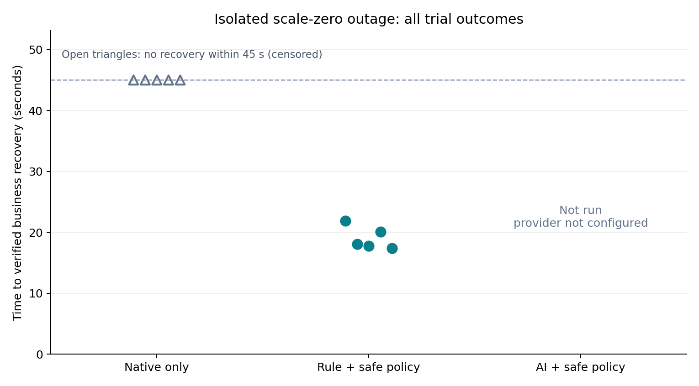
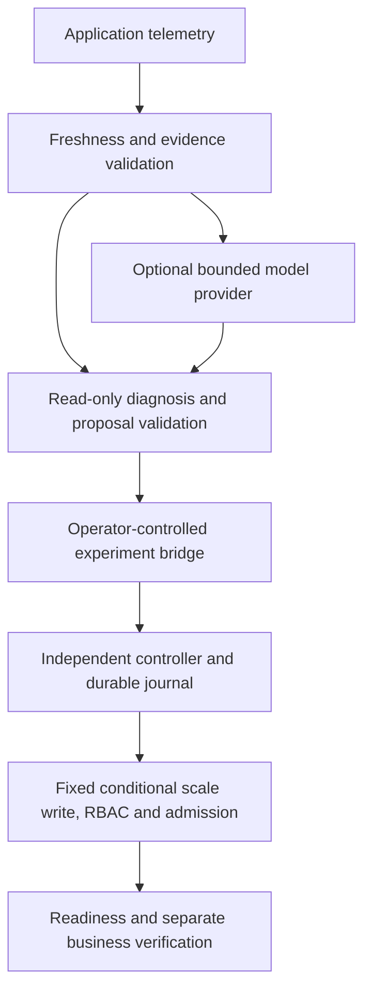

# SafeHeal AI — Kubernetes incident diagnosis where the model proposes and a controller decides

[](https://github.com/Jill-Vekariya/safeheal-ai/actions/workflows/tests.yml)

[](LICENSE)

**[Explore the browser simulation](https://jill-vekariya.github.io/safeheal-ai/)** · [Recorded CPU study](evidence/public-release/CPU_STUDY.md) · [Research report](docs/RESEARCH_REPORT.md) · [Reproduce](docs/REPRODUCIBILITY.md)



## The problem

"Self-healing infrastructure with AI" usually means giving a language model kubectl. That is a bad idea: the model can be wrong, can be prompt-injected through logs, and has no concept of blast radius. SafeHeal separates the two jobs. A read-only diagnosis layer (rule-based or model-based) proposes a cause; a deterministic controller with exactly one enrolled action decides whether anything may change, under RBAC, admission control, rate limits and a durable journal. Then I measured whether the AI actually helped.

## What I built

- **A synthetic three-service application** (gateway → order → payment) on a local kind cluster, with Prometheus telemetry and injected faults.
- **Evidence validation:** diagnosis proposals are checked against fresh telemetry before they count; stale or unsupported proposals are rejected.
- **An independent recovery controller** with one action (scale the payment Deployment from 0 back to 1), identity and spec guards, single-flight claims, dry-run by default and operator approval or explicit autonomy.
- **A controlled experiment** comparing native Kubernetes behaviour, a fixed rule and AI diagnosis across repeated trials, with cleanup verification after every trial and failed or unrun arms retained in the record.
- **A browser simulation** with six scenarios, dry-run review, approval flow and audit export, no cluster required.

## Results

| Arm | Business recovery within 90 s | Notes |
| --- | --- | --- |
| Native Kubernetes | **0 / 5** | Scale-to-zero is not something the scheduler repairs |
| Fixed rule | **5 / 5** | The rule is deliberately well matched to the one enrolled action |
| AI diagnosis | **2 / 5** | Five real requests, four validated outputs, three did not recover in time |

15/15 cleanup checks passed. 581 Python tests and 9 browser-engine tests pass in CI; the [Kubernetes CI run](https://github.com/Jill-Vekariya/safeheal-ai/actions/runs/41883711959) completed 12 native/rule fault trials with successful cleanup for every attempted trial. This is one scenario on one machine. It argues for the controller design and against trusting AI recovery by default; it does not establish general AI superiority or inferiority. [Multi-fault comparison](docs/STAGE4_COMPARISON.md) · [CPU study](evidence/public-release/CPU_STUDY.md)

## Where this applies

- **SRE and platform teams** evaluating AIOps tools: the question is not "can the model diagnose" but "what is it allowed to touch, and did it beat the runbook".
- **Regulated workloads** where every production change needs an approval trail and an auditable journal.
- **Anyone building agents that act on infrastructure:** the model-proposes / controller-decides split is reusable far beyond Kubernetes.

## Architecture



The model has no shell, no Kubernetes credential and no approval authority. [Architecture](ARCHITECTURE.md) · [Recovery contract](docs/SAFE_RECOVERY.md) · [Kubernetes setup](docs/KUBERNETES.md)

## Quick start

Requires Python 3.12. Default tests use mocks; no cluster or API key needed.

```bash
git clone https://github.com/Jill-Vekariya/safeheal-ai.git
cd safeheal-ai
python3.12 -m venv .venv
.venv/bin/python -m pip install -r requirements.lock
.venv/bin/python -m pip install --no-deps -e .
.venv/bin/python -m pytest -q
```

Browser simulation locally: `python -m http.server 8080 --directory docs/demo`. Full application with Docker: `docker compose up --build -d --wait` then `.venv/bin/python scripts/smoke.py`. Isolated kind recovery lab: [DEMO.md](docs/DEMO.md). Everything else: [reference guide](docs/REFERENCE.md).

## What I learned

<!-- Rewrite these in your own words before you point a recruiter here. Short, specific, first person. -->

- A validated diagnosis and a successful recovery are different outcomes, and a study has to count them separately.
- The rule beat the model because the action space was tiny. That is an argument for small action spaces, not against models.
- Cleanup verification after every trial is what makes the numbers trustworthy.

## Limits

- Single-machine prototype with one enrolled action and small exploratory studies.
- A supported symptom is not an established physical cause.
- Hash-chained local logs are not immutable against a privileged host administrator.
- Fresh real-model and live Kubernetes validation of the hardened transport is still open.

[Full limitations](docs/RESEARCH_REPORT.md) · [Security](SECURITY.md) · [Project history](docs/history/README.md)

## How this was built

I used AI coding assistants throughout this project. [HOW_THIS_WAS_BUILT.md](docs/HOW_THIS_WAS_BUILT.md) explains what was assisted, what I verified myself, and what I am still working through. The contribution table is in [INTERVIEW.md](docs/INTERVIEW.md#personal-contribution-and-ai-assistance).

## License

[MIT](LICENSE).
