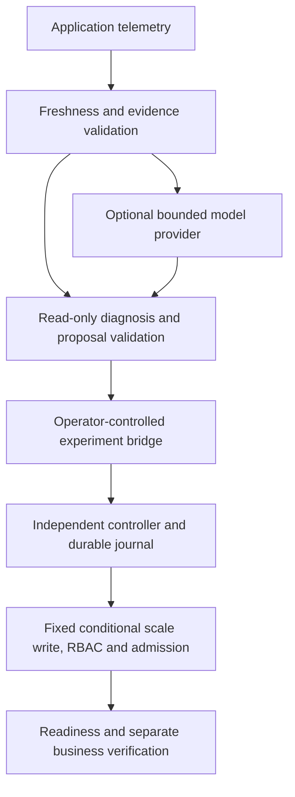

# SafeHeal AI

**Kubernetes incident diagnosis with independent, tightly bounded recovery authority.**

SafeHeal observes a synthetic gateway → order → payment application, validates telemetry-backed hypotheses and compares native behavior, a fixed rule and model diagnosis. A separate deterministic controller permits one enrolled action: restore the payment Deployment from zero replicas to one. The model has no shell, Kubernetes credential or approval authority.

[Research report](docs/RESEARCH_REPORT.md) · [Demo guide](docs/DEMO.md) · [Interview walkthrough](docs/INTERVIEW.md) · [Reproduction](docs/REPRODUCIBILITY.md)

## Interactive browser demo

Explore the [Recovery Lab prototype](docs/demo/README.md): six synthetic scenarios, dry-run review, operator approval, evidence snapshots and audit export. It makes no live model calls or Kubernetes writes and does not reproduce benchmark results.

Run `python -m http.server 8080 --directory docs/demo` from the checkout, then open http://localhost:8080. No API keys or additional dependencies are needed.

## What the evidence shows

| Evidence | Actual result | Scope |
| --- | --- | --- |
| [Historical CPU-model study](evidence/public-release/CPU_STUDY.md) | Native 0/5, fixed rule 5/5, AI 2/5 business recoveries within 90 seconds; 15/15 cleanups | One scale-zero scenario; as-run source `fd809cae41b60c62b59bd2fc2e2377f5d487b163` |
| Same CPU study | Five real requests, four validated outputs; three AI trials did not recover within the horizon | Validated diagnosis and successful recovery are different outcomes |
| [Local Stage 4 checks](docs/INTERVIEW.md) | 100 selected tests passed | Mocked controller/provider and experiment-integrity paths; no new model inference or cluster mutation |
| [Earlier cohorts](docs/RESEARCH_REPORT.md) | Failed, interrupted, censored and unrun outcomes retained separately | Different hosts, horizons and prompt formats are not pooled |

These results do not establish general AI superiority, calibrated confidence, production reliability or a universal MTTR improvement. The rule is deliberately well matched to the narrow restoration policy.

## Architecture



The controller independently checks enrolled identity/spec, live state, approval or explicit operator-enabled autonomy, durable single-flight claims and rate limits. Dry-run is the default. An ambiguous write blocks automatic retry. The notification journal persists diagnosis; it does not dispatch recovery. [Recovery contract](docs/SAFE_RECOVERY.md).

## Quick start: offline inspection

Requires Git, Python 3.12 and dependency-download access. Linux commands:

```bash
git clone https://github.com/Jill-Vekariya/safeheal-ai.git
cd safeheal-ai
python3.12 -m venv .venv
.venv/bin/python -m pip install -r requirements.lock
.venv/bin/python -m pip install --no-deps -e .
.venv/bin/python -m pytest -q
```

For Windows, use `py -3.12 -m venv .venv` and `.venv\Scripts\python.exe`; [the reproduction guide](docs/REPRODUCIBILITY.md) supplies complete PowerShell commands. Default tests use mocks; real-provider integration is opt-in.

Historical evidence replay must use its recorded source rather than a later modified checkout:

```bash
git worktree add --detach ../safeheal-recorded-release a95d0b5c216094052e0c37e7d99d1242dcea03d4
.venv/bin/python ../safeheal-recorded-release/scripts/reproduce.py --output .local/reviewer-replay-01
```

Choose unused worktree/output paths. Replay checks artifact integrity, numerical results and read-only audit chains; it makes no model call and needs no cluster. A source-hash mismatch on newer code must not be hidden by rewriting the historical inventory.

## Run the application or recovery lab

With a running Docker Linux engine and Compose v2, from the installed checkout:

```bash
docker compose up --build -d --wait
.venv/bin/python scripts/smoke.py
docker compose down
```

The gateway binds to `127.0.0.1:18080` and makes no real payment. Compose runs the application; it is distinct from the Kubernetes recovery experiment. [Kubernetes setup](docs/KUBERNETES.md) and [the end-to-end demo](docs/DEMO.md) cover the isolated kind lab, explicit execution guards and cleanup. The [recorded CPU study run](https://github.com/Jill-Vekariya/safeheal-ai/actions/runs/40206671248) is historical CI evidence, not a passing run of later local changes. Running a new workflow creates a new experiment with its own outcomes.

## Verification and limits

The local transport review adds pre-append response byte caps, identity-encoding checks and fixed failure codes; [its protocol](docs/STAGE3_PROTOCOL.md) distinguishes synthetic checks from historical model evidence. Fresh real-model and live Kubernetes validation of that transport remains open. Network phase timeouts and checks between chunks cannot forcibly preempt arbitrary synchronous code.

This is a single-machine prototype with one action, small exploratory studies and local operator trust. A supported symptom is not an established physical cause. Hash-chained local logs are not externally immutable against a privileged host administrator. [Architecture](ARCHITECTURE.md) · [Full limitations](docs/RESEARCH_REPORT.md) · [Project history](PROJECT_STATUS.md).

## Ownership and next work

Implementation, experiments and preparation materials used AI assistance. The [contribution table](docs/INTERVIEW.md#personal-contribution-and-ai-assistance) marks personal claims requiring owner confirmation; automated checks do not establish independent authorship or understanding. [Portfolio preparation](docs/PORTFOLIO.md).

Next: a preregistered live compatibility run, reviewed new incident families and calibrated diagnosis evaluation. A repository license has not been selected; licensing requires an explicit owner decision.
