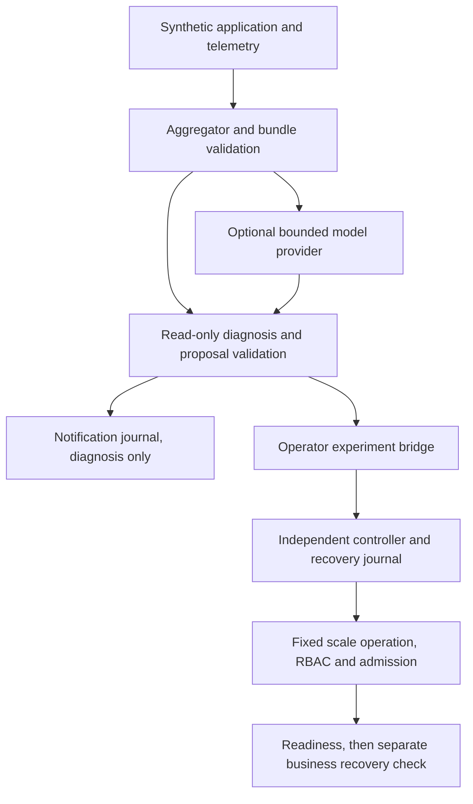

# SafeHeal AI — technical interview guide

[Working demo](https://jill-vekariya.github.io/safeheal-ai/) — live hosted simulation with synthetic evidence; it does not execute the recovery controller.

Stage 4 review: 27 October 2026. Rehearsal material describes the implementation; it is not a personal contribution record.

## Evidence boundary

| Item | Status and scope |
| --- | --- |
| Reviewed source | **VERIFIED by inspection:** base `a95d0b5c216094052e0c37e7d99d1242dcea03d4` plus the existing, uncommitted Stage 3 provider/agent/Kubernetes transport changes. Use `git status --short` and `git diff HEAD`; the base SHA alone does not identify the working source. |
| Current transport | **VERIFIED locally:** 100 selected boundary/controller/experiment-integrity tests passed in Stage 4. They do not call a real model or mutate a cluster. This is a focused subset, not the complete suite. [Protocol](STAGE3_PROTOCOL.md). |
| Historical real model | [CPU study](../evidence/day9/analysis-ci-cpu-40206671248/FINDINGS.md): native 0/5, fixed rule 5/5, AI 2/5 business recoveries within 90 seconds. All 15 cleanups passed. Four of five model outputs validated. These are historical observations, not a run of the new transport. |
| Fresh live validation | **UNVERIFIED:** real-model compatibility and live Kubernetes execution of the Stage 3 patch. No general reliability or AI-superiority estimate follows from the fixture counts. |

## 60-second pitch

SafeHeal is a Kubernetes incident-response testbed for a synthetic gateway, order and payment application. Its main engineering question is how to use model diagnosis without granting the model recovery authority. Fresh telemetry becomes a bounded evidence bundle. The model can rank supported hypotheses, but deterministic code checks every reference and always labels diagnosis as non-executable. A separate controller permits one enrolled action: restore the payment Deployment from zero replicas to one. It checks identity, approval or operator-enabled autonomy, durable claims and live preconditions before one conditional write. The project retains failed and censored experiments. In one narrow historical CPU-model study, the rule recovered five of five trials and AI two of five. The defensible result is inspectable control boundaries and failure evidence, with no demonstrated general AI advantage.

## Three-minute walkthrough

**0:00–0:40 — Problem and observation.** Open [the application architecture](../ARCHITECTURE.md) and show gateway → order → payment. Explain that scale-to-zero is a valid desired Kubernetes state: the native controller is not expected to reverse an operator's desired state. This fixture measures a deliberately explicit restoration policy, not generic crash healing. In [evidence.py](../services/diagnosis/evidence.py), `Aggregator` and `validate_bundle` separate observations from supported classifications. A scrape failure cannot by itself establish a process exit.

**0:40–1:20 — Untrusted diagnosis.** Open [provider.py](../services/diagnosis/provider.py), then [agent.py](../services/diagnosis/agent.py). `JsonProvider.propose` has an explicit call reservation, input/output budgets, no automatic retries, network phase timeouts and cooperative elapsed checks. `validate_proposal` checks service, classification, finite confidence and every evidence reference. Failure returns a labelled deterministic fallback; explicit model abstention stays abstention. Neither is silently counted as a successful model diagnosis. `execution_allowed` remains false.

**1:20–2:10 — Independent action authority.** Show `ai_support` in [controlled_core.py](../scripts/controlled_core.py), which permits only the supported real-model payment-unavailable condition into the experimental recovery bridge. The operator harness constructs the fixed request; it does not interpret generated commands. In [controller.py](../services/recovery/controller.py), follow `parse_request`, `identity`, `Journal` and `Controller.run`. Explain dry-run, single-use approval, enrollment, durable claim-before-write and one conditional scale operation. An ambiguous write is marked uncertain and never automatically retried. Three ready observations are controller verification; the experiment's successful order requests establish business recovery separately.

**2:10–3:00 — Demonstrate a failure and bound the claim.** Run the mocked controller/provider tests below and inspect a denial and a successful conditional patch. Open the historical CPU findings and account for all 15 trials, including three AI non-recoveries within the observation horizon. The Stage 3 synthetic comparison improved four specific boundary cases, but reused development fixtures cannot estimate population safety. Close with fresh live compatibility, broader incidents and confidence calibration as validation work still needed.

## Architecture and authority



The notification pipeline does not dispatch recovery. Diagnosis has no executor credential. Enrollment, approval, autonomy configuration and recovery-journal administration belong to the operator, outside model output.

## One end-to-end execution trace

Trace the **AI arm of the controlled scale-zero experiment**, not an always-running autonomous agent:

| Step | Path and symbol | Input, output or invariant |
| --- | --- | --- |
| 1 | [controlled_experiment.py](../scripts/controlled_experiment.py) · `trial` | Operator-owned harness sets up the enrolled fault trial and gathers evidence. Inspect its execution/preflight guards before any live command. |
| 2 | [evidence.py](../services/diagnosis/evidence.py) · `Aggregator`, `validate_bundle` | Fresh normalized observations, independently supported classes, evidence identifiers and hashes. Injection labels are not diagnostic input. |
| 3 | [provider.py](../services/diagnosis/provider.py) · `JsonProvider.propose`, `expand_selection` | Optional bounded JSON response; candidate indices expand only to independently derived candidates. The default provider is disabled. |
| 4 | [agent.py](../services/diagnosis/agent.py) · `DiagnosisAgent.diagnose`, `validate_proposal` | Validated supported hypotheses or explicit failure/fallback/abstention. Diagnosis never grants execution. |
| 5 | [controlled_core.py](../scripts/controlled_core.py) · `ai_support` | Requires the supported real-LLM payment `endpoint_unavailable` result above threshold. Fallback cannot satisfy the AI bridge. |
| 6 | [controller.py](../services/recovery/controller.py) · `Controller.run`, `Journal.transaction` | Validate fixed typed request, enrolled UID/spec/live state, mode, durable single-flight and limits. Claim intent before the remote write. |
| 7 | [kubernetes.py](../services/recovery/kubernetes.py) · `KubernetesAPI.restore` | One conditional JSON Patch to the fixed scale path; no command text or arbitrary resource selection. |
| 8 | [controller.py](../services/recovery/controller.py) · `Controller._verify`; [controlled_core.py](../scripts/controlled_core.py) · `metrics` | Require three ready observations; separately replay sustained healthy business requests and retain non-recovery/censoring. |

An optional notification path uses [notifications.py](../services/diagnosis/notifications.py) · `NotificationPipeline.handle` to claim before diagnosis and persist fixed failure codes. A crash leaves a pending/uncertain claim that suppresses automatic retry. This is distinct from the recovery journal.

## Design decisions and alternatives

| Implemented choice and rationale | Trade-off | When to reconsider |
| --- | --- | --- |
| One allowlisted 0→1 action; [controller.py](../services/recovery/controller.py) | Narrow demonstrated usefulness; cannot repair arbitrary incidents. | Add a separately specified action with independent preconditions, privileges, verification and failure tests. |
| No automatic provider/write retries; [provider.py](../services/diagnosis/provider.py), [controller.py](../services/recovery/controller.py) | A transient failure can leave useful work incomplete. | Introduce retry only with idempotency/reconciliation and an explicit bounded cost/authority model. |
| SQLite durable claims before remote work; [notifications.py](../services/diagnosis/notifications.py) | Crash suppression can require operator reconciliation; local journals are not highly available. | Multi-host requirements would justify coordinated durable state and a tested recovery protocol. |
| Evidence-grounded structured output, capped subjective confidence; [agent.py](../services/diagnosis/agent.py) | Supported symptoms are not established physical causes; confidence is uncalibrated. | A reviewed incident corpus and calibrated evaluation could justify changing thresholds or hypothesis semantics. |
| Identity encoding and pre-append byte caps; [provider.py](../services/diagnosis/provider.py) | Providers that insist on compressed responses may fail compatibility. A byte cap does not cap transport-buffer or process RSS. | Test actual provider behavior before implementing bounded decompression or process isolation. |

## Challenging questions and accurate answers

**Can a confident model bypass approval?** No. Proposal validation cannot grant authority. The recovery controller imports no diagnosis/provider module and independently validates its request, configuration, enrollment, approval/autonomy and live target state. Test [untrusted proposal rejection](../tests/test_safe_recovery.py) in `test_untrusted_proposal_cannot_grant_authority`.

**Why is a conditional patch needed after a read?** The target may change between read and write. UID/spec/generation checks and JSON Patch preconditions constrain the exact state transition. A race must deny the change; see `test_scale_race_is_rejected` and `test_spec_change_between_deployment_and_scale_reads_is_rejected` in [controller tests](../tests/test_safe_recovery.py).

**What if the write timed out after reaching Kubernetes?** Its outcome is ambiguous. The durable claim becomes uncertain, and follow-up execution is blocked rather than blindly retried. This sacrifices automatic liveness to avoid an unproven second action. An operator must inspect and reconcile actual state.

**Does the timeout impose a hard total deadline?** No. HTTP phase timeouts and between-chunk monotonic checks bound specific waits/cooperative progress. They cannot forcibly interrupt arbitrary synchronous transport code. The mocked tiny-chunk test establishes when checks run, not hard preemption.

**Why did the rule beat AI?** The fixture directly exposes payment unavailability and has only one recovery action, favoring the fixed rule. The historical CPU study shows 5/5 versus 2/5 within its horizon; it does not establish why every AI non-recovery occurred or predict other incident types. Inspect per-trial provider/controller/business records before attributing a cause.

**Does a hash-chained audit prove an attacker did not alter it?** It detects inconsistent edits under its verification assumptions. A privileged host user can rewrite files and recompute a chain. It is not an independently anchored or externally immutable security log.

**Does validated diagnosis prove a real AI recovery?** No. [verify_model_study.py](../scripts/verify_model_study.py) · `verify` requires the real provider call, validated diagnosis, controller verification, business recovery and audit to belong to the same trial. Disjoint aggregate successes are insufficient; see [the regression](../tests/test_model_study_verification.py).

## Supported debugging examples

| Example | Established cause/evidence | What remains a hypothesis |
| --- | --- | --- |
| Stage 3 paired run 001 falsely failed persisted-result comparisons | The evaluator compared JSON-decoded lists with in-memory tuples. Correcting serialization-aware comparison produced run 002: 15/19 baseline, 19/19 treatment. [Protocol and retained-run account](STAGE3_PROTOCOL.md). Application persistence was not repaired for this evaluator bug. | These development counts cannot predict a real-model success rate. |
| Large/compressed provider and executor responses | Pre-append caps and encoding rejection are exercised in [test_provider_boundary.py](../tests/test_provider_boundary.py). The new accumulation bound rejects before extending beyond its limit. | Compatibility with each actual provider and a whole-process memory ceiling remain unmeasured. |
| Historical replay refuses changed source | The original inventory includes source hashes. A replay on intentionally modified provider/agent code fails its source-identity check. [Reproducibility guide](REPRODUCIBILITY.md). Replay the exact recorded release separately. | Do not infer corrupt historical measurements merely from a newer working-tree mismatch. |

## Limits and useful next validation

- **Confirmed scope:** one-machine prototype, one enrolled recovery action, small exploratory studies, subjective confidence and local operator trust.
- **UNVERIFIED:** fresh live execution of the transport patch, wider fault generalization, cross-host coordination, calibrated diagnosis and continuous production cooldown behavior across experimental episode resets.
- Next useful work is a preregistered, budgeted live compatibility run with per-trial records, followed by reviewed new incident families. Repeatedly running known fixtures is regression checking, not new independent evidence.

## Personal contribution and AI assistance

| Claim | Evidence/status | What the owner must confirm |
| --- | --- | --- |
| Project goal and engineering-review requirements | User-supplied operating contract. | Which design choices and requirements were personally originated. |
| Implementation, experiments and interview material | AI-assisted work; source/tests/retained artifacts establish behavior, not independent human authorship. | Actual personally authored changes and their commits. |
| Personally reproduced/debugged a result | **Owner confirmation required.** No personal completion is inferred from this guide. | Date, command, output, lesson and the behavior explainable without notes. |
| Production incident response or customer impact | **UNVERIFIED; do not claim.** | Separate real experience/evidence if any; synthetic lab work does not establish it. |

Use project-centric pitch wording until personal contribution is confirmed. Preserve the disclosures in [portfolio preparation](PORTFOLIO.md).

## Practical rehearsal checklist

Use the existing Python 3.12 environment, or install the pinned environment using [the reproduction guide](REPRODUCIBILITY.md). Commands below are from the repository root and make no real model call or cluster write:

```bash
git rev-parse HEAD
git status --short
git diff HEAD -- services/diagnosis services/recovery
.venv/bin/python -m pytest -q tests/test_safe_recovery.py tests/test_provider_boundary.py tests/test_controlled_experiments.py tests/test_model_study_verification.py
```

- [ ] Draw the model/controller credential boundary and explain why the notification path is diagnosis-only.
- [ ] Predict dry-run, approval denial, ambiguous-write, duplicate and stale-target outcomes from the controller tests before running them.
- [ ] Explain supported symptom versus physical cause, validated output versus correct output, and readiness versus business recovery.
- [ ] Open every CPU-study arm and retain failures in its denominator; do not impute a recovery time beyond the horizon.
- [ ] Explain why replay of the recorded release must use its recorded source, rather than weakening integrity checks to accept later code.
- [ ] Record one actual personal review/change in an ownership log after completing it. Live experiments remain a separately authorized activity.
