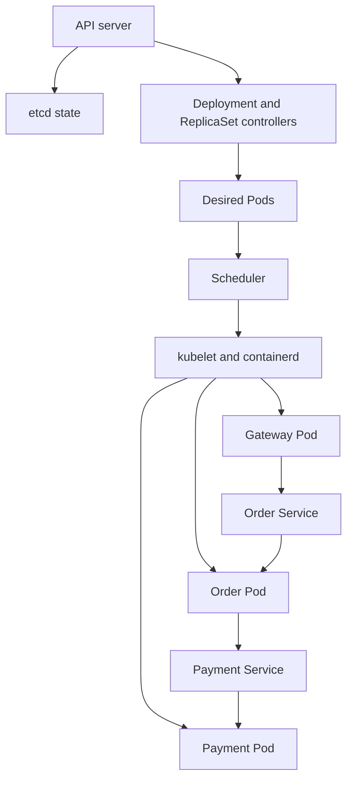

# Day 2: Kubernetes and distributed systems

## Run the local cluster

Prerequisites: Python 3.11+, Git, Docker running Linux containers, and a compatible
kubectl on PATH. The verified development computer uses Windows and Docker Desktop.
All commands below run from the repository root. The existing Day 1 Compose stack
uses port 18080; the optional Kubernetes gateway port-forward uses 18081.

```powershell
.\.venv\Scripts\python.exe scripts/k8s.py install-kind
.\.venv\Scripts\python.exe scripts/k8s.py setup
.\.venv\Scripts\python.exe scripts/k8s.py deploy
.\.venv\Scripts\python.exe scripts/k8s.py verify
.\.venv\Scripts\python.exe scripts/k8s.py recovery
.\.venv\Scripts\python.exe scripts/k8s.py recovery --execute
.\.venv\Scripts\python.exe scripts/k8s.py status
```

Linux x86_64 uses the same commands with `python3`. These orchestration scripts use
only the standard library; the application dependencies are installed inside the
image. Automated kind installation supports Windows/Linux x86_64, validates the
official release SHA-256, and writes only `.tools/`. Other platforms can place kind
v0.33.0 on PATH using the official instructions; they are not validated here.

`setup` creates or verifies a single-node `safeheal-dev` cluster. The node image is
Kubernetes v1.36.4, pinned by digest in the script. Its own `.local/kubeconfig` is
supplied explicitly to every cluster command. The user's default kubeconfig and
context are not modified. Both credential and tool directories are Git-ignored and
excluded from Docker's build context. Do not share the kubeconfig.

`deploy` builds the current source, gives the resulting image a tag derived from
its image ID, loads it directly into kind, renders Kustomize manifests, performs
server-side dry-run validation, applies them, and waits for all Deployments. Image
loading plus `IfNotPresent` avoids an external application-image registry. The
Python base-image tag and build tooling still float; the recorded image ID defines
the image actually used, and full byte-for-byte rebuilds are not yet guaranteed.

The scripts do not delete resources or reset an existing cluster. If an existing
named cluster lacks the expected ownership labels, they stop. Resolve that conflict
before proceeding instead of deleting another environment. Setup reuse and deploy
are intended for this project only; do not run a deployment concurrently with a fault.

## Data plane and control plane

The monitored application consists of three Deployments with one Pod each and
three internal ClusterIP Services. All live in namespace `safeheal-dev`.

| Service | Role | Downstream address | Probe port |
|---|---|---|---|
| gateway | Validates and forwards incoming orders | `http://order:8000` | 8000 |
| order | Calculates synthetic price, requests and checks receipt | `http://payment:8000` | 8000 |
| payment | Produces a simulated payment receipt | None | 8000 |

CoreDNS resolves a Service name to its stable virtual IP. Within the namespace,
`payment` resolves like `payment.safeheal-dev.svc.cluster.local`. Service selectors
match application Pod labels; EndpointSlices track the matching endpoints and their
readiness. Service routing uses those endpoints. Pod IPs can change without changing
the service URLs. DNS resolution alone does not prove a usable backend, so `verify`
also checks health, readiness, an end-to-end order, and correlated POST logs.



The API server receives declarative objects and stores cluster state in etcd.
Controllers reconcile desired and observed state. The scheduler assigns pending
Pods to a node based on eligibility and resource requests. The kubelet on that node
maintains containers through containerd and runs probes. In this small kind cluster,
control-plane and application workloads share one Docker container node; this saves
resources but offers no node-level high availability.

## Probe decisions

| Probe | Endpoint | Period / timeout / failure threshold | Effect |
|---|---|---|---|
| Startup | `/healthz` | 2 s / 2 s / 30 | Allows startup before readiness and liveness begin |
| Readiness | `/readyz` | 5 s / 4 s / 2 | Controls whether a Pod receives Service traffic |
| Liveness | `/healthz` | 10 s / 2 s / 3 | Restarts a persistently unresponsive container |

Liveness is local; it never calls dependencies. Readiness follows the existing
gateway-to-order-to-payment chain, so it may temporarily withdraw upstream endpoints
during a payment failure. Readiness does not itself restart containers. Probe
thresholds trade responsiveness against transient false failures; they are lab
settings, not production SLOs. Recursive readiness can multiply checks in larger
dependency graphs and should be reconsidered as the system grows.

## Native recovery demonstration

`recovery` without flags is a dry run. `recovery --execute` deliberately stops only
the validated payment container through the node's CRI (`crictl stop --timeout 0`).
It may briefly interrupt synthetic orders. The script verifies the loopback API,
project kubeconfig/context, kind Docker node, ownership labels, namespace, Pod UID,
container ID, role, readiness, and restart policy before stopping it. A local lock
rejects concurrent fault runs. An existing lock is never silently removed.

This is a developer-operated local test using Docker's privileged access to the
kind node. It is not the future agent executor or a least-privilege fault service.
Do not give these host privileges to an LLM. Application Pods have no API token or
RoleBinding. Future read-only observers and narrowly scoped recovery RBAC belong to
later milestones.

The recovery script never restarts a container, reapplies manifests, or deletes a
Pod. The kubelet restarts the stopped container under `restartPolicy: Always`.
It requires the same Pod UID, a changed container ID, a higher restart count, a
recorded termination, recovered readiness, and three successful in-cluster orders
with two-second gaps. Gateway/order must retain their UIDs and restart counts.
The captured exit code determines whether the runtime force-killed the process or
allowed a graceful termination; no exit code is assumed in advance.

A Pod deletion would instead exercise Deployment/ReplicaSet reconciliation and
create a replacement Pod with a new UID. That is a different experiment. Likewise,
the container-stop check does not prove the liveness-failure threshold, node-failure
recovery, load balancing among replicas, or zero downtime.

Each executed recovery saves a unique JSON record under `evidence/day2/`, including
failed attempts. The host elapsed interval includes CLI/API/poll delays and the
post-recovery checks. It is an engineering acceptance measurement, not benchmark
MTTR, a statistical estimate, or evidence of an AI benefit. Repeated matched trials
and a predeclared sustained-health window remain future work.

## Inspect the result

```powershell
# Keep this command running to open http://127.0.0.1:18081/docs locally.
.\.venv\Scripts\python.exe scripts/k8s.py port-forward
```

In a second terminal:

```powershell
.\.venv\Scripts\python.exe scripts/smoke.py http://127.0.0.1:18081
kubectl --kubeconfig .local/kubeconfig --context kind-safeheal-dev -n safeheal-dev get pods,services
kubectl --kubeconfig .local/kubeconfig --context kind-safeheal-dev -n safeheal-dev get endpointslices
kubectl --kubeconfig .local/kubeconfig --context kind-safeheal-dev -n safeheal-dev describe pod -l app.kubernetes.io/name=payment
kubectl --kubeconfig .local/kubeconfig --context kind-safeheal-dev -n safeheal-dev logs deployment/payment --previous
```

Use Ctrl+C to end the port-forward. The cluster remains available for inspection.
No public ingress, LoadBalancer, or NodePort is created. Namespace separation and
Pod Security are not a network isolation boundary: this setup has no NetworkPolicy
enforcement. It is an isolated local lab, not production security hardening.

## Failure modes and troubleshooting

- Missing Docker/Linux engine: start Docker Desktop and select Linux containers.
- Checksum mismatch: stop; inspect the expected release and downloaded tool.
- Image pull/load failure: inspect Docker connectivity and disk space; do not reset
  unrelated Docker projects. The script preserves an existing cluster on failure.
- Unready application: inspect Pod events and logs; confirm service labels, DNS,
  downstream URLs, and resource availability. A running process can still be unready.
- Recovery timeout: inspect the saved failed record, Pod state, and previous logs.
  Do not claim completion or issue an automatic manual restart.
- Existing recovery lock: check for an active recovery process; only remove the lock
  manually after establishing that the owner is gone and the cluster is healthy.

## Concepts to explain in an interview

1. Which component restarts a container, and which replaces a deleted Pod?
2. Why should a dependency outage affect readiness but not local liveness?
3. Why is a stable Service name useful when Pod IPs change?
4. Why do resource requests affect scheduling while limits constrain execution?
5. Why does one successful restart prove neither high availability nor AI value?
6. Why can recovery time measured through a CLI differ from service downtime?

## Primary references

- [kind quick start](https://kind.sigs.k8s.io/docs/user/quick-start/)
- [kind v0.33.0 release and image digests](https://github.com/kubernetes-sigs/kind/releases/tag/v0.33.0)
- [Kubernetes DNS for Services and Pods](https://kubernetes.io/docs/concepts/services-networking/dns-pod-service/)
- [Kubernetes probes](https://kubernetes.io/docs/concepts/workloads/pods/probes/)
- [Kubernetes Pod lifecycle and restart policy](https://kubernetes.io/docs/concepts/workloads/pods/pod-lifecycle/)
