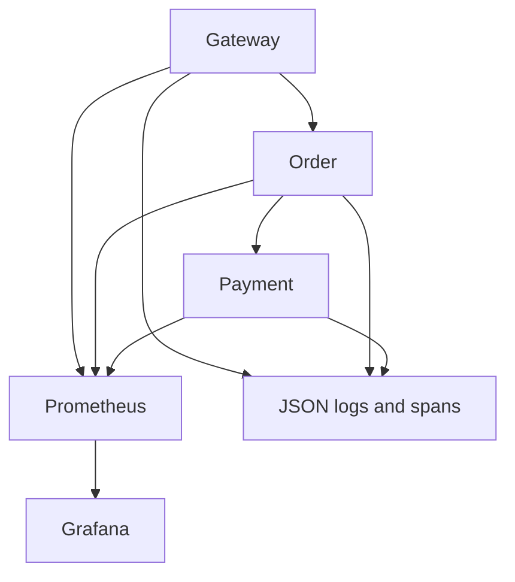

# Day 3 observability pipeline

Gateway, order and payment expose `/metrics` and emit JSON request logs and OpenTelemetry spans.
Prometheus scrapes the three ClusterIP Services every five seconds. Grafana uses the provisioned
Prometheus datasource and the versioned **SafeHeal Operations** dashboard. This is a single-node,
one-replica lab. Observability requires no Kubernetes API credentials and sends no telemetry to a cloud service.



## Metrics and interpretation

| Metric | Type / unit | Meaning |
|---|---|---|
| `safeheal_http_requests_total` | Counter / requests | Completed application HTTP calls, including 4xx and 5xx |
| `safeheal_http_request_duration_seconds` | Histogram / seconds | Elapsed time through ASGI response completion, including downstream waits |
| `safeheal_http_requests_in_progress` | Gauge / requests | Active application calls per service |
| `up{job="safeheal"}` | Prometheus gauge | Scrape success; does not assert application readiness |

Counter and histogram labels: `service`, `method`, `route`, `status_class`. Routes use the
framework's route template, unknown paths use `__unmatched__`, and unknown methods use `OTHER`.
No request/order/payment IDs, raw URLs, query strings or payloads enter metric labels.
Health, readiness and metric scrapes are excluded from application counters, histograms and spans.
Request logs still record probes for diagnostics, with null trace fields. `/metrics` is not logged.

Histogram bucket boundaries in seconds: 0.005, 0.01, 0.025, 0.05, 0.1, 0.25, 0.5, 1, 2, 3,
5, 10, plus infinity. The bounds cover fast local requests and the existing two/three-second
dependency timeouts. Quantiles are bucket estimates, not individual-request timings.

Error percentage means `5xx request rate / all application request rate * 100`; 4xx validation
errors have a separate panel. Rates use one-minute windows and per-service aggregation.
Counters can reset on process restart; `rate()` accounts for resets in the observed series.
Zero traffic produces an undefined percentage, not evidence of zero errors. Readiness checks
are independent of liveness; telemetry does not change this behaviour or retry POST calls.

## Logs and basic distributed tracing

JSON request events contain UTC timestamp, service, validated request ID, normalized method/route,
HTTP status, duration, exception type, trace ID and span ID. Bodies, query strings and exception
messages/stacks are omitted. Existing application `x-request-id` correlation continues end to end.

OpenTelemetry manual instrumentation creates a SERVER span for each measured inbound request and
a CLIENT span around each downstream HTTP call. The W3C `traceparent`/`tracestate` propagator
extracts/injects context. A successful gateway -> order -> payment request has five linked spans:
gateway SERVER -> gateway CLIENT -> order SERVER -> order CLIENT -> payment SERVER.
An invalid incoming trace context starts a new trace. Sampling follows the SDK's parent-based
default; fresh lab traces are sampled. Received unsampled traces can still be correlated in request
logs but are not exported. Each app has its own tracer provider and Prometheus registry.

A small synchronous JSON span exporter writes completed spans to container logs. Span events
include IDs, parent ID, kind, status, timestamps, duration and bounded HTTP attributes.
5xx/exception outcomes mark spans ERROR; 4xx remains a separate HTTP outcome. No collector,
Jaeger, Tempo or Grafana trace datasource is configured. Thus basic propagation can be verified
from actual spans, but there is no trace-search UI or persistent trace store. Console export
adds synchronous logging overhead; benchmark that overhead before drawing performance conclusions.
Trace/request IDs are evidence identifiers and never authorization credentials.

## Reproduce the lab

From the repository root, use the project virtual environment or an environment installed from
`requirements.lock` and `pip install --no-deps -e .`:

```powershell
.\.venv\Scripts\python.exe scripts/k8s.py status
.\.venv\Scripts\python.exe scripts/k8s.py deploy
.\.venv\Scripts\python.exe scripts/observe.py deploy
.\.venv\Scripts\python.exe scripts/observe.py verify
```

Setup/reuse the dedicated kind cluster via the Day 2 runbook if it is not already available.
`observe.py deploy` checks ownership, server-validates digest-pinned Prometheus/Grafana manifests and waits
for both rollouts. The designated kind node pulls its native image platform directly. Configuration
and dashboard ConfigMaps are generated by Kustomize with content hashes.

Open separate terminals for local viewing:

```powershell
.\.venv\Scripts\python.exe scripts/observe.py forward-grafana
.\.venv\Scripts\python.exe scripts/observe.py forward-prometheus
```

Grafana: `http://127.0.0.1:13000/d/safeheal-operations`; Prometheus: `http://127.0.0.1:19090`.
The Grafana image is pinned to its Linux amd64 manifest, matching this lab; Prometheus uses a pinned multi-platform index.
These URLs work on the development computer while their forwards run. Both Services are
ClusterIP and forwarding explicitly binds loopback. No ingress, NodePort or public URL is created.
Grafana uses an anonymous Viewer for this isolated lab, with signup, basic authentication,
login form and initial admin creation disabled. Do not expose this configuration publicly.

Eight dashboard panels cover request rate, server error percentage, p50/p95 latency,
completed request outcomes, target health, mean latency, client error percentage and
latency-bucket rates. A bucket panel is cumulative by design. Configuration is the source
of truth; manual edits are disabled. Datasource requests are executed through Grafana itself
during acceptance, in addition to querying Prometheus directly.

## Acceptance and fault visibility

`observe.py verify` records a real 45-second diagnostic workload with valid orders and invalid
quantities, then verifies scrape targets, every dashboard expression, Grafana health, the
provisioned dashboard, the Grafana datasource proxy, correlated logs and five-span parentage.
Baseline/final checks use Service DNS and require confirmed synthetic orders.

The diagnostic workload targets the validated gateway Pod IP to preserve observation when
readiness removes Service endpoints. It is not a production traffic or availability measurement.
The default verifier injects no fault. The following explicit option repeats the already
authorized, guarded Day 2 payment-container-stop test while traffic runs:

```powershell
.\.venv\Scripts\python.exe scripts/observe.py verify --native-fault
```

This option validates cluster/namespace/node ownership, uses the existing exclusive fault lock,
stops the validated payment CRI container and requires native recovery plus observed application
5xx and Prometheus error samples. No Pod deletion or manual restart is used. Previous payment
container logs are also collected so early spans remain attributable across the restart.
This host privilege belongs to a developer acceptance script; it is not an LLM recovery tool.

Raw success/failure evidence is retained under `evidence/day3/`; native recovery also retains
its Day 2-format record. Evidence includes source hashes, working-tree state, actual HTTP
outcomes, PromQL responses, Grafana responses, trace/log events and final health checks.
CI deploys the same stack and runs non-fault observability acceptance after Day 2 recovery.

## Resource and research limitations

Each monitoring container requests 100m CPU / 128Mi and limits 500m / 512Mi. Prometheus
retains at most 24 hours / 256 MB of TSDB blocks with a 1Gi ephemeral volume; WAL/head
overhead is additional. Grafana uses 256Mi ephemeral data. Both run non-root with a read-only
root filesystem, dropped capabilities, seccomp and no ServiceAccount token. Recreated Pods
lose local monitoring data; Git configurations and committed evidence preserve reproducibility.

Static Service targets are correct only for the current single replica. With multiple replicas,
replace them with bounded per-Pod discovery and review cardinality/RBAC before experiments.
Scrape intervals and one-minute windows delay signals; a brief outage may occur between scrapes.
No metrics-server, Loki, durable storage, alerting controller, AI diagnosis or production SLO is
introduced on Day 3. Preserve failed acceptance runs. Demonstrated telemetry is engineering
evidence and does not establish an AI benefit, MTTR, high availability or performance improvement.

## Primary references

- [Prometheus instrumentation practices](https://prometheus.io/docs/practices/instrumentation/)
- [Prometheus metric types](https://prometheus.io/docs/concepts/metric_types/)
- [Grafana provisioning](https://grafana.com/docs/grafana/latest/administration/provisioning/)
- [OpenTelemetry Python instrumentation](https://opentelemetry.io/docs/languages/python/instrumentation/)
- [OpenTelemetry propagation](https://opentelemetry.io/docs/languages/python/propagation/)
