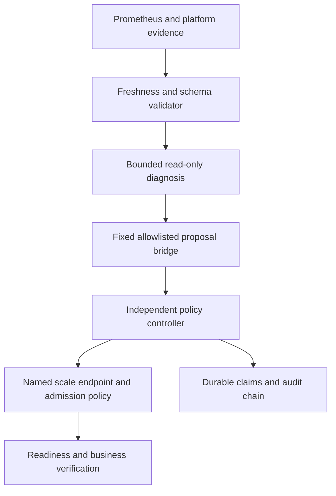
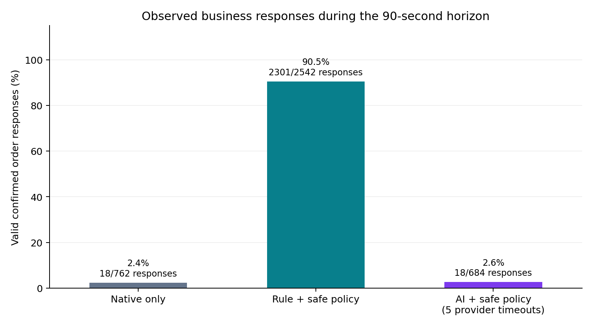

# SafeHeal AI: bounded diagnosis and independently authorized recovery

## Abstract

SafeHeal AI is a three-service synthetic application and an experimental incident-response pipeline. It separates fallible model diagnosis from a deterministic controller with one enrolled Kubernetes action. The technical question is whether model ranking adds useful recovery behavior beyond a fixed symptom rule when both operate behind the same policy. The contribution is an inspectable implementation and reproducible evidence, rather than a new diagnosis algorithm or a claim of general autonomous operations.

## Problem and motivation

An incident assistant can confuse correlated failures, stale observations and instructions embedded in logs. Giving that assistant a shell makes an erroneous interpretation an execution decision. This project makes observations, hypotheses and authority distinct. Prometheus samples establish symptoms; a structured ranker may propose hypotheses; a separate operator-configured controller decides whether one exact live-state transition is permitted. Explicit uncertainty and negative results are part of the output.

The application routes a synthetic order through gateway, order and payment services. No real financial transaction is performed. Each service exposes health/readiness and metrics. Fixed topology helps interpret downstream symptoms, but also limits external validity.

## System and trust boundaries

The model receives normalized evidence and candidate hypotheses. It has no shell, Kubernetes credential, approval interface or arbitrary network tool. Evidence references must independently support the proposed service and observable class. Unknown fields, unsupported references and unsafe action proposals are rejected. Missing, malformed or stale evidence and provider errors produce documented abstention or low-confidence fallback; fallback is never promoted to AI success.

The independent controller permits only `restore_payment_replica`: an enrolled `safeheal-dev/payment` Deployment may transition from desired replicas zero to one. Operator configuration pins UID and template digest. Live corroboration, ownership, generation and a conditional JSON Patch constrain races. A dedicated short-lived service-account token can read the named Deployment and read/patch its scale subresource. A fail-closed admission policy independently limits that identity to the exact transition. No pod/exec, secrets, arbitrary Deployment patch or namespace deletion authority exists.

Dry-run is default. Approval is expiring, single-use and bound to request/spec/generation. Autonomous mode requires operator opt-in. Claim-before-write, duplicate prevention, single-flight execution, cooldown and attempt limits persist in a local journal. An ambiguous write remains running/uncertain and blocks further execution; there is no automatic write retry. Three consecutive exact-generation readiness observations verify the action, and an operator harness separately checks real orders through Service routing.

The host operator and its fixture/cleanup harness are trusted administrative components. They are not model tools. Local OS administrators can rewrite the audit store. No hostile same-user isolation, remote tamper-proof logging or production multi-tenant security is established.

## Methodology

The original six retained Day 5 trials cover process termination, HTTP errors and latency, each twice. Native recovery or bounded fault leases are distinguished from active intervention. Day 6 replay evaluated evidence attribution with mocked providers and deterministic fallback; those scores are engineering checks, not real-model accuracy.

Day 8 uses 36 fixed synthetic robustness cases and an exact-Git before/after comparison. The development suite improved from 27/36 to 36/36 with nine improvements and zero regressions. Repeated-notification simulated provider calls fell from five to one. These cases informed development and are not a held-out benchmark.

Day 9 uses matched blocks with native-only, fixed-rule-plus-policy and AI-plus-policy arms. Arm order is seeded and shuffled inside each block. The protocol is recorded before injection; it is not externally preregistered. The same payment desired-replicas-zero fixture and controller apply to active arms. The decision begins eight seconds after the injection request. Two closed-loop workers submit confirmed-order requests with a four-second timeout and a 0.2-second post-completion delay. Sustained business recovery requires at least three valid responses below 0.5 seconds, spanning at least two seconds, after a witnessed failure.

Ground truth is attached after diagnosis and never passed to the ranker. Timing uses host monotonic intervals and includes observation delay and API overhead. Recovery is right-censored at the declared horizon. Restricted time `min(T,H)` is reported separately from observed-only recovery means; an unrecovered trial is not an observed MTTR of H seconds. Operator restoration after measurement is excluded.

Each trial is a fresh operator-enrolled episode with its own journal and expiring token. Production cooldown/hourly limits remain unchanged, but behavior across episode resets is not evaluated. The model cannot perform resets.

## Verified baseline results

The retained original cohort (`evidence/day9/run-primary`) contains five native trials and five fixed-rule trials, plus five explicit AI slots not run while provider configuration was absent. Its horizon is 45 seconds.

| Arm | Actual trials | Recovery within 45 s | Observed recovery mean |
|---|---:|---:|---:|
| Native | 5 | 0; all censored | Unknown |
| Fixed rule + policy | 5 | 5 | 19.0378 s |
| AI + policy | 0 | Not measured | Not measured |

The rule median is 18.063 s. Mean paired native-minus-rule restricted-time difference is 25.9622 s, with an exploratory paired bootstrap interval of [24.2838, 27.3438] s. This interval describes resampling of five shared-cluster blocks, not population precision. Valid completed responses were 17/345 (4.9%) for native and 1219/1370 (89.0%) for the rule. Closed-loop throughput changes with failures, so these percentages are not elapsed-time uptime.

All 80 predefined forbidden API probes were denied; all five controller actions verified; all ten attempted trials passed cleanup. Five native fixtures needed operator restoration after observation. The 60-file manifest, 1767 raw request rows and 20 audit events are retained. Earlier failed Day 7 attempts and their corrections remain recorded; later success does not overwrite failure.

## Configured local-model cohort

A new full matched cohort is retained at `evidence/day9/run-local-20261025`, separately from the original missing-provider study. Every arm used a predeclared **90-second** horizon; no outcomes from the 45-second cohort are pooled with it. Source is pinned at `79270ecf1fbd4b515591f6f478346657cfa0ebc4`. It completed all 15 slots, including five genuine local-provider request attempts.

The selected model was `qwen2.5:1.5b-instruct-q4_K_M` (GGUF Q4_K_M, digest `65ec06548149b04c096a120e4a6da9d4017ea809c91734ea5631e89f96ddc57b`) served by Ollama 0.40.10 on loopback. Model weights were downloaded; inference used the local computer. The budget was five requests, at most 800 output tokens per request and a configured 30-second transport timeout, with no retries. The cloud proposal was rejected before execution; zero cloud diagnosis calls were made.

| Arm | Trials | Recovered within 90 s | Censored | Observed mean (s) | Restricted mean (s) |
|---|---:|---:|---:|---:|---:|
| native | 5 | 0 | 5 | Unknown | 90.000 |
| rule_policy | 5 | 5 | 0 | 30.544 | 30.544 |
| ai_policy | 5 | 0 | 5 | Unknown | 90.000 |

Provider outcomes: `{'provider_timeout': 5}`. Mean measured model-stage interval: **31.987 s**. This host interval includes runtime/client construction and scheduling; the transport timeout is not a measured strict wall-time bound. No validated model output was returned in this cohort, so target/symptom accuracy cannot be estimated. These are operational provider outcomes, not evidence that the model cannot diagnose the fault.

Paired restricted-time comparisons, left minus AI: `{'native_minus_ai_policy': {'paired_restricted_differences_seconds': [0.0, 0.0, 0.0, 0.0, 0.0], 'mean_seconds': 0.0, 'exploratory_bootstrap_95': [0.0, 0.0]}, 'rule_policy_minus_ai_policy': {'paired_restricted_differences_seconds': [-69.0, -64.625, -61.875, -55.14100000000326, -46.64100000000326], 'mean_seconds': -59.4564000000013, 'exploratory_bootstrap_95': [-65.825, -51.93780000000261]}}`. Equal restricted values for censored arms do not imply equal actual recovery time. No general AI superiority or equivalence follows. The rule's observed times are `[21.0, 25.375, 28.125, 34.85899999999674, 43.35899999999674]` seconds.

Retained **4035 raw request rows**, a finalized raw manifest, **20 verified audit events**, and **120 denied-operation probes** (all 403). Cleanup passed in 15/15 trials; 10 operator restorations occurred after observation and are excluded from recovery. No trial executor token file remains. Reported token usage is `{'input_tokens': 0, 'output_tokens': 0}`; failed requests can consume compute without returning usage. Actual total monetary/hardware/electricity cost is unmeasured.

Low available host memory was observed during preparation. Shared-host contention, model cold/warm state and telemetry carryover were not independently controlled or instrumented as causal factors. The increasing rule timings in this cohort cannot be interpreted as a software regression against the earlier 45-second cohort. No cloud-provider performance result is established.

## Post-study cleanup hardening and source provenance

Review found that the operator harness could label an unexpected external replica count as clean even though it only restored zero. The final version rejects counts outside zero/one and requires exactly one ready replica after cleanup; seven safety regression cases cover count, UID and spec drift. No such out-of-scope count occurred in the retained trials. The independent controller, policy, measurement algorithm and recorded outcomes were unchanged. Historical instruments are retained under `evidence/final/instruments` and verified against each protocol's declared hashes. The later guard is distinguished from the measured version rather than silently relabelling the experiment.

## Accuracy, time, cost and safety trade-offs

The fixed rule is simple, deterministic and independent of model availability. A model introduces transport/runtime latency, output validation, token usage and abstention without expanding recovery authority. In this one-action symptom task the model has little opportunity to add capability. Target/symptom agreement measures agreement with observed labels, not causal root-cause discovery. Confidence values are subjective and capped, not calibrated probabilities.

Provider usage is retained where available. Paid inference cost, electricity, hardware amortization and total operating cost require separate measurement; absent billing is not a zero-cost estimate. Safety probes and unit tests establish specific denied operations and failure behavior, not a population probability of unsafe execution.

## Threats to validity and inconclusive outcomes

Only one deliberately policy-addressable configuration fault is used in Day 9. Kubernetes reconciles desired state and therefore does not naturally change desired replicas from zero back to one; the fixture favors an explicit restore rule. It does not demonstrate generic crash recovery superiority. Five blocks, one shared machine/cluster, sequential execution, warm caches, overlapping telemetry windows, Windows scheduling and instrumentation overhead limit generalization. There are no benign-control false-positive estimates, randomized multi-host experiments or held-out real-model robustness scores. An unconstrained model baseline was intentionally not given credentials; no empirical comparison with unrestricted autonomous execution is claimed.

The initial AI slots were not run and remain missing. An inconclusive or rejected real-model result is a valid experimental outcome, provided raw observations and failure reasons are retained. No AI superiority, production readiness, universal MTTR gain, academic novelty or admission outcome follows from this work.

## Related work and design context

References and the specific relationship to this implementation are recorded in [RELATED_WORK.md](RELATED_WORK.md). Kubernetes reconciliation and admission controls motivate the separation between desired state and allowed mutation. SRE monitoring practice motivates symptom-based evidence. Prior microservice diagnosis research motivates causal caution: topology and correlated telemetry alone do not establish the initiating mechanism. This implementation does not reproduce published benchmark datasets or claim to outperform those methods.

## Reproducibility and future work

See [REPRODUCIBILITY.md](REPRODUCIBILITY.md) for a clean checkout, dependency pins, offline evidence replay and guarded live lab commands; [DEMO.md](DEMO.md) for a 3–5 minute walkthrough. Future work includes held-out benign and ambiguous incidents, more independent fault types, blocked multi-host trials, calibrated uncertainty, provider outage experiments with real providers, external audit storage, protected operator enrollment and continuous-service rate-limit evaluation. Expand recovery actions only with separate invariants, least-privilege permissions, admission constraints and verification criteria.

## Final CI failure handling

The first publication CI run (40135721425, source f9a3073376657cab491baccd167b7d0e83b7d6b2) passed unit/replay checks and six fault trials, then failed its fresh-install recovery negative check: a scale-to-two server dry-run returned HTTP 200. It stopped before fault injection or controller invocation. The failure is retained, not replaced by a passing result. Applying a policy was insufficient evidence of enforcement at that instant.

Operator bootstrap now requires two consecutive policy-specific denials using the real dedicated token, with only fixed server dry-runs, before writing controller configuration. Unrelated RBAC denials do not qualify. Thirteen new failure-path tests cover pending/absent enforcement, interrupted consecutive observations, transport/bounds failures and configuration release. The local real-token gate passed without injecting a fault or changing replicas; all eight strict forbidden checks still returned 403. At this earlier bootstrap checkpoint, full Windows tests were 522 passed, 2 skipped. The original experimental cohorts and as-run source remain unchanged; these bootstrap checks occur before their measurement clock begins. See evidence/final/ci-40135721425 and admission-gate-live.json.

## Published release verification

Implementation 34be70d4cf845c53e91dbffd1ba9cea7e47a2366 passed [PR CI 40140051368](https://github.com/Jill-Vekariya/safeheal-ai/actions/runs/40140051368), merged through [PR4](https://github.com/Jill-Vekariya/safeheal-ai/pull/4) preserving history, and passed [main CI 40142094894](https://github.com/Jill-Vekariya/safeheal-ai/actions/runs/40142094894) at 990073fd5e2e3c0c6490d81c638e983c875924d1. Both fresh Kubernetes jobs exercised autonomous/approval recovery, observability/detection and six repeated faults. Windows: 522 passed, 2 skipped; offline replay: 235 artifacts. Successful logs/raw artifacts are archived separately from the failed run. These are engineering checks, not extra randomized experimental trials or evidence of AI benefit.

## Public CPU model study - verified implementation

A fresh isolated Linux GitHub runner completed five randomized matched blocks and all 15 planned scale-zero trials with the predeclared 90-second horizon. Its exact implementation source is `fd809cae41b60c62b59bd2fc2e2377f5d487b163`. The separate standard demo and normal CI passed at that source: Linux 559 passed, 1 opt-in skip; Windows 558 passed, 2 expected skips.

| Arm | Attempts | Recovered / 5 | Censored | Observed mean (s) | Restricted mean (s) |
|---|---:|---:|---:|---:|---:|
| native | 5 | 0 | 5 | Not measured | 90.000 |
| rule_policy | 5 | 5 | 0 | 14.107 | 14.107 |
| ai_policy | 5 | 2 | 3 | 14.836 | 59.934 |

The AI arm made 5 real local CPU-model requests, with provider statuses {"provider_invalid_response": 1, "validated": 4}. It recorded 2 independently controller-verified recoveries and 2 sustained business recoveries within the horizon. Reported token usage was {"input_tokens": 2106, "output_tokens": 134}; failed requests may consume compute without returning usage. Actual monetary compute cost is unknown.

All 15 cleanup checks passed, all 120 forbidden probes returned HTTP 403, and 28 audit events verified. The model had no Kubernetes credential, shell tool, approval power or action authority. The runner pinned the official Ollama image and base model digest, served inference only on loopback, disabled cloud inference, capped it at two CPUs and 1536 MiB, and warmed the model outside measurement. Model metadata confirms CPU residency.

Full evidence validation precedes compact candidate projection, and expanded selected hypotheses are checked independently. This ranks deterministic evidence-supported candidates; it is not unrestricted root-cause discovery. Confidence is uncalibrated. The same independent one-action policy constrains rule and AI arms.

The two Windows CPU attempts remain incomplete: six of fifteen attempted before interruption, then nine of fifteen before a cleanup rollout timeout. The latter preserves eight passed cleanups, one failed cleanup and six unrun slots; a later independent healthy-order check does not change that failure. The original 45-second baseline and larger-model timeout cohort remain unchanged. No attempt was replaced or resumed, and differing hosts, horizons, runtimes or prompt formats are not pooled.

Six retrospective development incidents also produced six grounded, target-matched and observable-class-matched real-model diagnoses without fallback. Those are development checks, not held-out accuracy. One policy-addressable scenario, five shared-host blocks, warm state, telemetry windows, closed-loop workload and host contention limit generalization. Observed-only means exclude censored observations; the horizon is not observed MTTR. No general AI superiority, calibrated diagnostic accuracy, production safety rate or universal recovery gain is established. CPU/memory fault coverage, held-out benign controls, multi-host replication and external audit anchoring remain future research.

Raw measurements: `evidence/day9/run-ci-cpu-40206671248`. Full findings and charts: `evidence/day9/analysis-ci-cpu-40206671248`. Permanent CI archives and source/runtime provenance: `evidence/public-release/ci-40206671248` and `ci-40206669554`.
